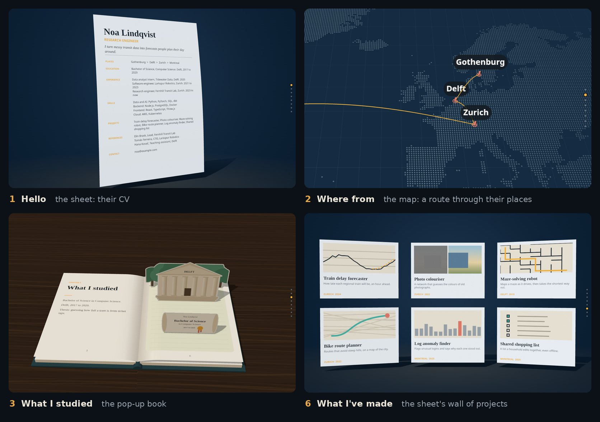

# Storyfolio

[](#project-status)
[](https://github.com/xitij27/storyfolio/actions/workflows/library-pages.yml)
[](LICENSE)
[](package.json)
[](#get-started)
[](https://github.com/xitij27/storyfolio/commits/main)

**Your profile, made into a portfolio site that introduces you in 3D.**

Storyfolio is a skill for AI coding agents. Give your agent a resume, a
LinkedIn export, GitHub links or project notes. It checks the facts with
you, then builds a one-page site: one long scroll in eight chapters, each a
3D picture of what it is about, flowing into the next.



[See it running](https://xitij27.github.io/storyfolio/transitions/) ·
[Get started](#get-started) · [How it works](#how-it-works) ·
[Read the skill](skills/storyfolio/SKILL.md) · [MIT License](LICENSE)

## Project status

Storyfolio is in active development, built in four stages.

| Stage | What it delivers | Status |
|---|---|---|
| 1. Method | Reading a profile, facts the person confirms, a storyboard of the whole page | ✅ Implemented and evaluated |
| 2. Engine | The reusable 3D scroll [engine and site scaffold](skills/storyfolio/engine/README.md) | ✅ Complete, approved on desktop and phone |
| 3. Build | The skill's stops 2 to 6: the site running from the second stop, then its look, its words and a checked whole site | 🚧 In progress |
| 4. Packaging | Release package, installation proof, full build documentation | ⏳ Follows stage 3 |

Where stage 3 stands (28 October 2026):

- Sites are now built from three ready-made 3D worlds: a sheet of paper, a
  map and a pop-up book. Each can tell any of the eight chapters, and a site
  mixes them, one world per chapter. Between two worlds the camera dives
  through a card into the next.
- Three looks (night, daylight and blueprint), the person's own words for
  any chapter, a printable CV and project pages. One command checks the
  whole site at desktop and phone size, and without JavaScript or WebGL.
- A dry run on a made-up person passes every check. It also showed what to
  fix next: the map, for places very far apart or very close together,
  and for long jobs.
- Next: a test in which a fresh agent builds a made-up person's site from
  start to finish, then a review of that site on a desktop and a phone,
  which closes stage 3.

[The handover](docs/handover.md) records the latest state, the author's
decisions and the test evidence, and opens with the next steps.

## How it works

The agent stops six times. At each stop you decide one thing; between stops
it works by itself.

| Stop | Your agent brings you | You decide |
|---|---|---|
| **1. Read** | A fact sheet from your material, and questions only you can answer | Confirm the facts |
| **2. Concept** | Your site, already running: one world per chapter, with a reason for each | Accept it, or swap pieces from the [gallery](https://xitij27.github.io/storyfolio/transitions/) |
| **3. Storyboard** | The script of the whole page | Say yes, or ask for changes |
| **4. Look** | The whole site in two or three looks | Choose one |
| **5. Words** | What opens on a click (each project, your CV) and three versions of the opening and closing words | Choose the wording |
| **6. Finish** | The checked site, and what still needs your eyes | Your own review |

Nothing about you is invented. Every claim on the site, down to the small
ones a sentence makes on its way, is checked against the facts you
confirmed. The agent asks you only about facts, claims that could
embarrass you, what a visitor sees first, and anything that publishes,
costs money, or shows another person or an employer's work. It decides the rest and writes each decision down, with how to
change it.

If you ask only for a plan, the agent stops at the storyboard.

## Eight chapters, three worlds

The site introduces you in the same eight chapters, in order: hello, where
from, what I studied, where I've worked, what I'm good at, what I've made,
what others say, get in touch. A chapter with nothing to show is left out.
Everything on the scroll is brief, and more opens on a click.

| World | How it tells a chapter | How it moves to the next |
|---|---|---|
| **Sheet** | Your CV is one sheet of paper that bends into each picture: a leaflet of your skills, a wall of your projects, your contact page | It folds from one picture into the next |
| **Map** | Each chapter stands where it happened: a route through your places, a building for each job, as tall as your years there | The camera flies from place to place |
| **Pop-up book** | Each chapter is a spread: the words on the left, a scene standing up on the right | The page turns, folding one scene flat and raising the next |

Every picture and word comes from your own details. The
[gallery](https://xitij27.github.io/storyfolio/transitions/) shows each
world through all eight chapters with two made-up people, and every
chapter's piece on its own.

## Get started

You need an AI agent that can read the skill and write files in your
portfolio project. To build the site, it also needs Node.js 22.18 or later
and npm. A plan alone needs neither.

Clone the public repository with Git, or download it using GitHub's
**Code → Download ZIP** menu:

```bash
git clone https://github.com/xitij27/storyfolio.git
cd storyfolio
```

Install the complete `skills/storyfolio/` folder in your agent's skill
directory, including `references/`, `engine/` and `scripts/`. Use that
agent's activation method to select `storyfolio`. The following examples
use a Bash-compatible shell; replace `/path/to/your-portfolio` with your
project's location.

### Codex

From the cloned `storyfolio` directory, copy the skill to your portfolio:

```bash
mkdir -p /path/to/your-portfolio/.agents/skills
cp -R skills/storyfolio /path/to/your-portfolio/.agents/skills/
```

Open your portfolio project in Codex and select Storyfolio through `/skills`
or mention `$storyfolio` in your prompt. See the official
[Codex skill documentation](https://learn.chatgpt.com/docs/build-skills)
for discovery and configuration details.

### Claude Code

From the cloned `storyfolio` directory:

```bash
mkdir -p /path/to/your-portfolio/.claude/skills
cp -R skills/storyfolio /path/to/your-portfolio/.claude/skills/
```

Start Claude Code in your portfolio project and invoke `/storyfolio`.
See the official [Claude Code skill documentation](https://code.claude.com/docs/en/skills)
for other installation locations and activation details.

### Any other agent

If your agent supports local skills, copy the same folder into its documented
skill directory. If it accepts files as instructions, give it `SKILL.md` and
all six files in `references/`, keeping their names and paths where
possible.

For an agent that can read a checkout directly, start in your portfolio
project and use the following prompt, adjusting the skill path:

```text
Read /path/to/storyfolio/skills/storyfolio/SKILL.md and follow it.
Read its reference files when the skill directs you to.
Make my portfolio site from the material I provide, starting with the
factual review. Save the working record in this project's docs/story/ folder.
```

Reading the instructions makes the method available; automatic discovery,
building and file saving depend on your agent's tools. If it can only chat,
you will need to supply the references and save its documents yourself.

## Start the conversation

You can begin with a resume, an exported LinkedIn profile, GitHub links,
project notes, writing, talks, or an existing portfolio. Tell your agent
where to find the material and what you want visitors to do.

For example, after activating the skill:

```text
Use Storyfolio to make my portfolio site.

My resume is in material/resume.pdf, and my project notes are in
material/projects.md. I want visitors to understand my work and contact me
about engineering roles.

Start by reading the material and asking me what needs confirming.
```

Your first reply from the agent is only the facts and its questions. It
holds back the design until you have answered, because a resume leaves out
exactly what a site must not get wrong: whose result a number was, what a
title hides, who took a photograph.

Share files you intend it to read, keep private correspondence and contact
exports outside that material, and confirm permission for someone else's
photos, quotes, or employer work before including them.

## What you leave with

A site in your own project, which no longer depends on the skill once it is
made, and the record of how it was decided:

```text
your-portfolio/
├── content/
│   ├── person.ts         Your confirmed facts, as the site reads them
│   ├── mix.ts            Which world tells each chapter
│   └── site.ts           Your look, your own words, where your CV is
├── app/                  The Next.js site: the story at /, your CV, project pages
└── docs/story/
    ├── facts.md          Your facts, where each came from, and your answers
    ├── concepts.md       The mix, why each piece, and your answer
    ├── storyboard.md     The script of the whole page
    ├── decided-for-you.md  What the agent decided without asking, and how to change it
    └── handover.md       What exists, what you said, what comes next
```

`npm run check` builds the site and checks it the way visitors meet it. A
later session, with the same agent or another, picks up from these files.
Publishing is your call: the agent asks before anything goes live.

## Component library

[Browse the library](https://xitij27.github.io/storyfolio/): portfolio pieces
running, listed by the chapter of a site they serve, each with the files to
copy. Its source is [`skills/storyfolio/library/`](skills/storyfolio/library/README.md).

## Where it came from

Storyfolio grew out of [Kshitij's research-paper portfolio](https://xitij27.vercel.app),
where pages become the story's structure. Its method and evaluations are
recorded in this repository so the reasoning can be examined and improved.
The people in its tests and screenshots are made up.

## Contribute

Questions, ideas, and examples from your own use are welcome in
[GitHub issues](https://github.com/xitij27/storyfolio/issues).

For code or instruction changes, read [AGENTS.md](AGENTS.md) and
[the current handover](docs/handover.md). New skill instructions need evidence
from an evaluation that shows why they are necessary, followed by a rerun.
For local contributor checks, use Node.js 22.18 or later with native
TypeScript support:

```bash
node evals/check-skill.mjs
node evals/check-people.mjs
npm test
```

The [documentation map](docs/README.md), [evaluation runbook](evals/README.md),
and [study catalogue](evals/studies.md) link the design and test evidence.

## License

[MIT](LICENSE). You can use, adapt, and share Storyfolio under its terms.
