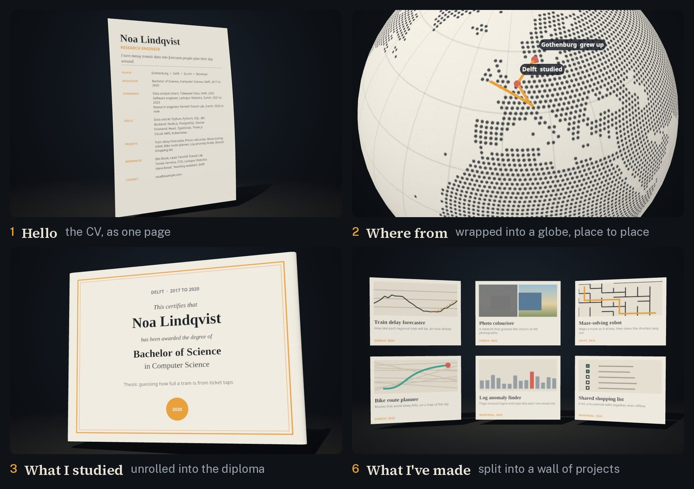
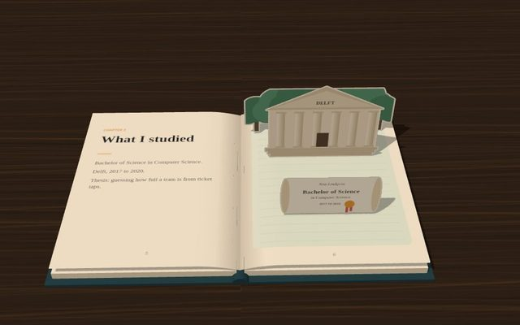
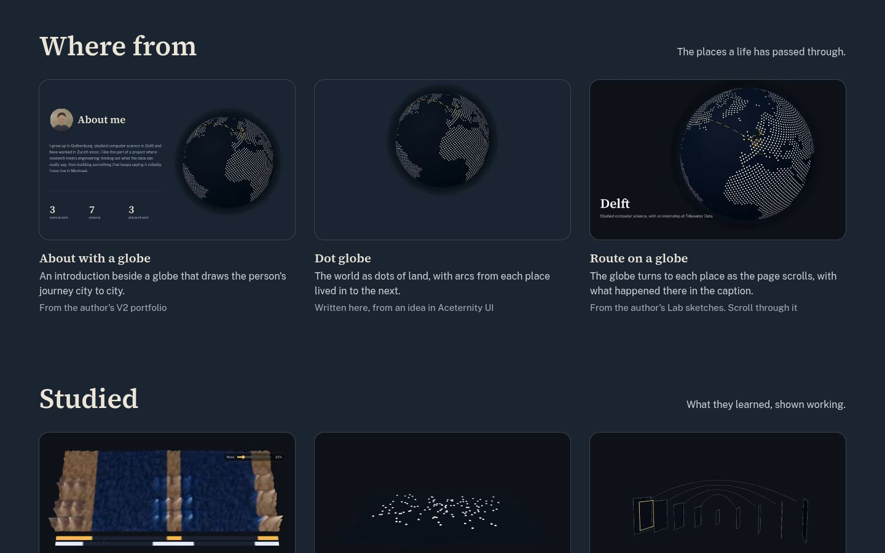

<div align="center">


<h1>Storyfolio</h1>

<p><strong>Your profile, made into a portfolio site that introduces you in 3D.</strong></p>

<p>An agent skill for Claude Code and Codex. Give your agent a resume, a LinkedIn export,<br>
GitHub links or project notes. It checks the facts with you, then builds a one-page site<br>
told in one 3D world, where each chapter grows out of the last as you scroll.</p>

[](https://github.com/xitij27/storyfolio/releases/tag/v0.1.0) [](https://github.com/xitij27/storyfolio/actions/workflows/library-pages.yml) [](LICENSE) [](package.json) [](#get-started) [](https://github.com/xitij27/storyfolio/commits/main)

<p>
  <a href="https://xitij27.github.io/storyfolio/transitions/whole/sheet/"><strong>Watch a site</strong></a>
  &nbsp;&nbsp;|&nbsp;&nbsp;
  <a href="https://xitij27.github.io/storyfolio/">Gallery</a>
  &nbsp;&nbsp;|&nbsp;&nbsp;
  <a href="#get-started">Get started</a>
  &nbsp;&nbsp;|&nbsp;&nbsp;
  <a href="#how-it-works">How it works</a>
  &nbsp;&nbsp;|&nbsp;&nbsp;
  <a href="skills/storyfolio/SKILL.md">Read the skill</a>
</p>

<a href="https://xitij27.github.io/storyfolio/transitions/whole/sheet/"></a>

<sub>Four chapters of a made-up person's site, all on one sheet of paper. <a href="https://xitij27.github.io/storyfolio/transitions/whole/sheet/">Watch it move</a>.</sub>

</div>

<br>

## Three worlds

The site introduces you in the same eight chapters, in order: hello, where
from, what I studied, where I've worked, what I'm good at, what I've made,
what others say, get in touch. A chapter with nothing to show is left out.
Everything on the scroll is brief, and more opens on a click. The whole
site is told in one of three worlds, the one that suits you:

<table>
  <tr>
    <td width="33%" valign="top">
      <a href="https://xitij27.github.io/storyfolio/transitions/whole/sheet/"></a>
      <h3>Sheet</h3>
      Your CV is one sheet of paper that bends into each picture: a leaflet of your skills, a wall of your projects, your contact page.
      <br><br><sub>It slides, folds or swings from one picture into the next; you pick the move.</sub>
    </td>
    <td width="33%" valign="top">
      <a href="https://xitij27.github.io/storyfolio/transitions/whole/map/"></a>
      <h3>Map</h3>
      Each chapter stands where it happened: a route through your places, a building for each job, as tall as your years there.
      <br><br><sub>The camera flies from place to place.</sub>
    </td>
    <td width="33%" valign="top">
      <a href="https://xitij27.github.io/storyfolio/transitions/whole/book/"></a>
      <h3>Pop-up book</h3>
      Each chapter is a spread: the words on the left, a scene standing up on the right.
      <br><br><sub>The page turns, folding one scene flat and raising the next.</sub>
    </td>
  </tr>
</table>

Every picture and word comes from your own details. The
[gallery](https://xitij27.github.io/storyfolio/) shows each world through
all eight chapters with two made-up people, and every chapter's picture in
each world.

## How it works

The agent stops six times. At each stop you decide one thing; between stops
it works by itself.

| Stop | Your agent brings you | You decide |
|---|---|---|
| **1. Read** | A fact sheet from your material, and questions only you can answer | Confirm the facts |
| **2. Concept** | Your site, already running in one world, and why that world suits you | Accept it, or choose another world from the [gallery](https://xitij27.github.io/storyfolio/) |
| **3. Storyboard** | The script of the whole page | Say yes, or ask for changes |
| **4. Look** | The whole site in two or three looks, and the sheet's moves | Choose one |
| **5. Words** | What opens on a click (each project, your CV) and three versions of the opening and closing words | Choose the wording |
| **6. Finish** | The checked site, and what still needs your eyes | Your own review |

> [!NOTE]
> **Nothing about you is invented.** Every claim on the site, down to the
> small ones a sentence makes on its way, is checked against the facts you
> confirmed. The agent asks you only about facts, claims that could
> embarrass you, what a visitor sees first, and anything that publishes,
> costs money, or shows another person or an employer's work. It decides
> the rest and writes each decision down, with how to change it.

If you ask only for a plan, the agent stops at the storyboard.

## Get started

**You need** an AI agent that can read the skill and write files in your
portfolio project. To build the site, it also needs Node.js 22.18 or later
with its built-in TypeScript support, and npm. A plan alone needs neither.
Some Linux distributions build Node without it: if
`node -p process.features.typescript` prints `false`, install Node from
[nodejs.org](https://nodejs.org/) instead.

**1. Get the skill.** In Claude Code you can skip to the plugin in step 2.
Otherwise, clone only the skill from the public repository (the full
repository also holds about 1.6 GB of test records):

```bash
git clone --depth 1 --filter=blob:none --sparse https://github.com/xitij27/storyfolio.git
cd storyfolio
git sparse-checkout set skills
```

**2. Install it in your portfolio project.** Copy the complete
`skills/storyfolio/` folder, including `references/`, `engine/` and
`scripts/`, into your agent's skill directory, then select `storyfolio`
the way that agent activates skills. Each agent reads only its own
directory. The examples use a Bash-compatible shell; replace
`/path/to/your-portfolio` with your project's location. To update, copy
the folder again; to remove, delete it. A site already made does not
depend on it.

<details>
<summary><strong>Claude Code</strong></summary>

<br>

As a plugin, with no clone (`--sparse` fetches only the plugin):

```bash
claude plugin marketplace add xitij27/storyfolio --sparse .claude-plugin skills
claude plugin install storyfolio@storyfolio
```

Update with `claude plugin marketplace update storyfolio` then
`claude plugin update storyfolio@storyfolio`; remove with
`claude plugin uninstall storyfolio@storyfolio`.

Or copy the folder into your project, from the cloned `storyfolio` directory:

```bash
mkdir -p /path/to/your-portfolio/.claude/skills
cp -R skills/storyfolio /path/to/your-portfolio/.claude/skills/
```

Start Claude Code in your portfolio project and invoke `/storyfolio`.
See the official [Claude Code skill documentation](https://code.claude.com/docs/en/skills)
for other installation locations and activation details.

</details>

<details>
<summary><strong>Codex</strong></summary>

<br>

From the cloned `storyfolio` directory, copy the skill to your portfolio:

```bash
mkdir -p /path/to/your-portfolio/.agents/skills
cp -R skills/storyfolio /path/to/your-portfolio/.agents/skills/
```

Open your portfolio project in Codex and select Storyfolio through `/skills`
or mention `$storyfolio` in your prompt. See the official
[Codex skill documentation](https://learn.chatgpt.com/docs/build-skills)
for discovery and configuration details.

</details>

<details>
<summary><strong>Any other agent</strong></summary>

<br>

If your agent supports local skills, copy the same folder into its documented
skill directory. If it accepts files as instructions, give it `SKILL.md` and
all six files in `references/`, keeping their names and paths where
possible.

For an agent that can read a checkout directly, start in your portfolio
project and use the following prompt, adjusting the skill path:

```text
Read /path/to/storyfolio/skills/storyfolio/SKILL.md and follow it.
Read its reference files when the skill directs you to.
Make my portfolio site from the material I provide, starting with the
factual review. Save the working record in this project's docs/story/ folder.
```

Reading the instructions makes the method available; automatic discovery,
building and file saving depend on your agent's tools. If it can only chat,
you will need to supply the references and save its documents yourself.

</details>

**3. Start the conversation.** You can begin with a resume, an exported
LinkedIn profile, GitHub links, project notes, writing, talks, or an
existing portfolio. Tell your agent where to find the material and what you
want visitors to do. For example, after activating the skill:

```text
Use Storyfolio to make my portfolio site.

My resume is in material/resume.pdf, and my project notes are in
material/projects.md. I want visitors to understand my work and contact me
about engineering roles.

Start by reading the material and asking me what needs confirming.
```

Your first reply from the agent is only the facts and its questions. It
holds back the design until you have answered, because a resume leaves out
exactly what a site must not get wrong: whose result a number was, what a
title hides, who took a photograph.

> [!TIP]
> Share files you intend it to read, keep private correspondence and
> contact exports outside that material, and confirm permission for someone
> else's photos, quotes, or employer work before including them.

## What you leave with

A site in your own project, which no longer depends on the skill once it is
made, and the record of how it was decided:

```text
your-portfolio/
├── content/
│   ├── person.ts         Your confirmed facts, as the site reads them
│   ├── mix.ts            Which world tells the story
│   └── site.ts           Your look, your own words, where your CV is
├── app/                  The Next.js site: the story at /, your CV, project pages
└── docs/story/
    ├── facts.md          Your facts, where each came from, and your answers
    ├── concepts.md       The world, why it suits you, and your answer
    ├── storyboard.md     The script of the whole page
    ├── decided-for-you.md  What the agent decided without asking, and how to change it
    └── handover.md       What exists, what you said, what comes next
```

`npm run check` builds the site and checks it the way visitors meet it. A
later session, with the same agent or another, picks up from these files.
Publishing is your call: the agent asks before anything goes live.

<details>
<summary><strong>Running and publishing the site yourself</strong></summary>

<br>

In the site's folder:

```bash
npm ci             # the exact versions in its package-lock.json
npm run browsers   # Chromium for the checks
npm test           # then: npm run typecheck, npm run lint
npm run check      # build, and look at it at desktop and phone size
npm run dev        # work on it at the local address it prints
```

On Linux, Chromium needs the system's NSS, NSPR and ALSA libraries; if a
check fails with `libnspr4.so: cannot open shared object file`, install
them (on Ubuntu 24.04, `libnss3`, `libnspr4` and `libasound2t64`).

It is an ordinary Next.js app: `npm run build` then `npm start` serves it,
and any host that runs Next.js can publish it. Its dependencies are yours
from the moment it is made. It starts on Next.js 16.4.5; upgrade it as you
would any Next.js app, and run `npm run check` after.

</details>

## The gallery and the pieces

<a href="https://xitij27.github.io/storyfolio/pieces/"></a>

[The gallery](https://xitij27.github.io/storyfolio/) is what a site is
made from: the three worlds running through all eight chapters, with two
made-up people, the sheet's three moves, and each chapter's picture in each
world. The agent shows it to you at stop 2.

[The pieces](https://xitij27.github.io/storyfolio/pieces/) are older
portfolio sections and effects, from the author's own site and written
from outside ideas, each shown working with the files to copy. Both are
built from [`library/`](library/README.md).

## Project status

Storyfolio is in active development, built in four stages.

| Stage | What it delivers | Status |
|---|---|---|
| 1. Method | Reading a profile, facts the person confirms, a storyboard of the whole page | **Done**: implemented and evaluated |
| 2. Engine | The reusable 3D scroll [engine and site scaffold](skills/storyfolio/engine/README.md) | **Done**: approved on desktop and phone |
| 3. Build | The skill's stops 2 to 6: the site running from the second stop, then its look, its words and a checked whole site | **Done**: six person tests; the author approved the last site |
| 4. Packaging | Release package, installation proof, full build documentation | **Done**: [v0.1.0](https://github.com/xitij27/storyfolio/releases/tag/v0.1.0) released on 6 November 2026 |

<details>
<summary><strong>Where it stands (6 November 2026)</strong></summary>

<br>

- A site is told in one world, chosen at stop 2: the sheet, the map or the
  pop-up book. A chapter goes into another world only when the person asks.
- Six person tests have run a fresh agent through the stops for a made-up
  person. On the author's review the sheet tells a story best; the map's
  site lacked flow. The sixth site (the sheet, blueprint, sliding) was
  approved on 6 November, which closed stage 3.
- The sheet now moves between chapters in one of three ways (slide, fold
  or swing), and the person picks one at the look stop.
- Three looks (night, daylight and blueprint), the person's own words for
  any chapter, a printable CV and project pages. One command checks the
  whole site at desktop and phone size, and without JavaScript or WebGL.
- Stage 4: the package is frozen with a hash for every file. Unpacked
  outside this repository, it scaffolds a site that passes its tests and
  every check. Released as [v0.1.0](https://github.com/xitij27/storyfolio/releases/tag/v0.1.0).

</details>

<details>
<summary><strong>What has been tested, and what has not</strong></summary>

<br>

- **Agents.** Claude Code 2.1.314 installs the plugin from GitHub and lists
  the skill from `.claude/skills/`; Codex 0.162.1 lists it from
  `.agents/skills/`. The route for other agents is documented, not tested.
- **One model.** The person tests ran one model through Codex
  (`gpt-6.1-sol`, medium effort). The skill has not been tried on another.
- **One person for planning.** Since the second stop became a choice of one
  world, the planning stops have been tested on one made-up person.
- **Phones.** The checks render in software at phone size; how smoothly a
  site runs on a real phone has to be seen on one.
- **Without 3D.** Without JavaScript or WebGL, the page still shows the
  person's name, every chapter's words and the links; the checks confirm it.
- **Not part of the skill.** Reviewing an existing portfolio, and enforcing
  privacy rules on the material, are separate work that has not been built.

</details>

[The handover](docs/handover.md) records the latest state, the author's
decisions and the test evidence, and opens with the next steps.

## Where it came from

Storyfolio grew out of [Kshitij's research-paper portfolio](https://xitij27.vercel.app),
where pages become the story's structure. Its method and evaluations are
recorded in this repository so the reasoning can be examined and improved.
The people in its tests and screenshots are made up. One early review
of a real portfolio keeps only its written findings.

## Contribute

Questions, ideas, and examples from your own use are welcome in
[GitHub issues](https://github.com/xitij27/storyfolio/issues).

For code or instruction changes, read [AGENTS.md](AGENTS.md) and
[the current handover](docs/handover.md). New skill instructions need evidence
from an evaluation that shows why they are necessary, followed by a rerun.
For local contributor checks, use Node.js 22.18 or later with native
TypeScript support:

```bash
node evals/check-skill.mjs
node evals/check-people.mjs
npm test
```

The [documentation map](docs/README.md), [evaluation runbook](evals/README.md),
and [study catalogue](evals/studies.md) link the design and test evidence.

## License

[MIT](LICENSE). You can use, adapt, and share Storyfolio under its terms.

<br>

<div align="center">
<sub><a href="https://xitij27.github.io/storyfolio/">Gallery</a> &nbsp;|&nbsp; <a href="https://xitij27.github.io/storyfolio/pieces/">Pieces</a> &nbsp;|&nbsp; <a href="skills/storyfolio/SKILL.md">The skill</a> &nbsp;|&nbsp; <a href="https://github.com/xitij27/storyfolio/issues">Issues</a></sub>
</div>
