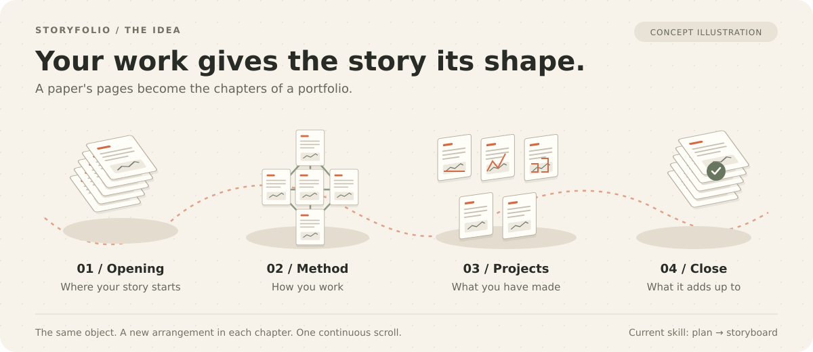

# Storyfolio

**One scroll. One story. One object from your work.**

Bring your resume, projects, and a few notes about how you work. Storyfolio
helps your AI agent turn them into a portfolio plan that feels like you:
a continuous story, carried by an object in 3D, with your work on its faces.



[Get started](#get-started) · [See the process](#how-it-works) ·
[Explore the skill](skills/storyfolio/SKILL.md) · [MIT License](LICENSE)

Storyfolio is a portable skill for any AI agent that can load local skills
or read instruction files. The current version takes you through an approved
storyboard.

Development now includes an experimental [stage 2 engine and scaffold](skills/storyfolio/engine/README.md)
with a plain scrolling test story. The shipped skill remains planning-only;
the six-stop build workflow and complete-portfolio proof are stage 3 work.
See [the handover](docs/handover.md) for verification and author-review status.

## A portfolio with a thread

What would happen if the way you work became the shape of your portfolio?

A research paper has a question, a method, experiments, and a conclusion.
A tasting menu has courses. An incident review has a timeline and action
items. Storyfolio looks for a form you already use, then finds the object
that can carry it through the page.

| Example | The story's form | The object that carries it |
|---|---|---|
| AI research and software engineering | A research paper | Pages that rearrange into diagrams and a wall of projects |
| A pastry chef who serves in courses | A tasting menu | Plates that carry each chapter |
| A reliability engineer who writes incident reviews | An incident review | Service-status tiles that rearrange through the story |

The illustration above shows the paper concept. The chef and engineer are
fictional examples from the [concept reference](skills/storyfolio/references/concept.md).
Each example shows how a concept follows from someone's actual work; your
agent develops three possibilities from your own material.

## How it works

You make three decisions. Your agent does the work between them.

| Step | Your agent brings you | You decide |
|---|---|---|
| **1. Read** | A fact sheet, gaps, and questions about your work | Confirm the facts and explain what matters |
| **2. Choose** | Three concepts, with a recommendation | Pick the direction you want to explore |
| **3. Storyboard** | A plan of the whole page: chapters, scroll beats, interactions, and fallbacks | Approve it or ask for changes |

The first reply starts with your facts. Once those are confirmed, the agent
can build a concept on the work you actually did. The storyboard also plans
for phones, reduced motion, and visitors who cannot use the 3D scene.

## Get started

You need an AI agent that can read the skill and its references. To keep the
planning record automatically, it also needs to write files in your portfolio
project. Planning needs no npm packages or build step.

Clone the public repository with Git, or download it using GitHub's
**Code → Download ZIP** menu:

```bash
git clone https://github.com/xitij27/storyfolio.git
cd storyfolio
```

Install the complete `skills/storyfolio/` folder in your agent's skill
directory, including `references/`. Use that agent's activation method to
select `storyfolio`. The following examples use a Bash-compatible shell;
replace `/path/to/your-portfolio` with your project's location.

### Codex

From the cloned `storyfolio` directory, copy the skill to your portfolio:

```bash
mkdir -p /path/to/your-portfolio/.agents/skills
cp -R skills/storyfolio /path/to/your-portfolio/.agents/skills/
```

Open your portfolio project in Codex and select Storyfolio through `/skills`
or mention `$storyfolio` in your prompt. See the official
[Codex skill documentation](https://learn.chatgpt.com/docs/build-skills)
for discovery and configuration details.

### Claude Code

From the cloned `storyfolio` directory:

```bash
mkdir -p /path/to/your-portfolio/.claude/skills
cp -R skills/storyfolio /path/to/your-portfolio/.claude/skills/
```

Start Claude Code in your portfolio project and invoke `/storyfolio`.
See the official [Claude Code skill documentation](https://code.claude.com/docs/en/skills)
for other installation locations and activation details.

### Any other agent

If your agent supports local skills, copy the same folder into its documented
skill directory. If it accepts files as instructions, give it `SKILL.md` and
all four reference files, preserving their names and paths where possible.

For an agent that can read a checkout directly, start in your portfolio
project and use the following prompt, adjusting the skill path:

```text
Read /path/to/storyfolio/skills/storyfolio/SKILL.md and follow it.
Read its reference files when the skill directs you to.
Plan my portfolio from the material I provide, starting with the factual
review. Save the working record in this project's docs/story/ folder.
```

Reading the instructions makes the method available; automatic discovery
and file saving depend on your agent's tools. If it can only chat, you will
need to supply the references and save its planning documents yourself.

## Start the conversation

You can begin with a resume, an exported LinkedIn profile, GitHub links,
project notes, writing, talks, or an existing portfolio. Tell your agent
where to find the material and what you want visitors to do.

For example, after activating the skill:

```text
Use Storyfolio to plan my portfolio.

My resume is in material/resume.pdf, and my project notes are in
material/projects.md. I want visitors to understand my work and contact me
about engineering roles.

Start by reading the material and asking me what needs confirming.
```

You do not need a concept in mind. Your answers help the agent find one.
Share files you intend it to read, keep private correspondence and contact
exports outside that material, and confirm permission for someone else's
photos, quotes, or employer work before including them.

## What you leave with

The planning record lives in your portfolio project:

```text
docs/story/
├── facts.md             Your facts, sources, and answers
├── concepts.md          Three directions and your chosen concept
├── storyboard.md        The page's chapters, beats, and interactions
├── decided-for-you.md   Agent decisions, reasons, and how to change them
└── handover.md          Current state and what comes next
```

These files give the next session a place to pick up the work. You leave with
an approved direction and storyboard to guide a later implementation.

## Where it came from

Storyfolio grew out of [Kshitij's research-paper portfolio](https://xitij27.vercel.app),
where pages become the story's structure. Its method and evaluations are
recorded in this repository so the reasoning can be examined and improved.

## Contribute

Questions, ideas, and examples from your own use are welcome in
[GitHub issues](https://github.com/xitij27/storyfolio/issues).

For code or instruction changes, read [AGENTS.md](AGENTS.md) and
[the current handover](docs/handover.md). New skill instructions need evidence
from an evaluation that shows why they are necessary, followed by a rerun.
For local contributor checks, use Node.js 22.18 or later with native
TypeScript support:

```bash
node evals/check-skill.mjs
node evals/check-people.mjs
npm test
```

The [documentation map](docs/README.md), [evaluation runbook](evals/README.md),
and [study catalogue](evals/studies.md) link the design and test evidence.

## License

[MIT](LICENSE). You can use, adapt, and share Storyfolio under its terms.
