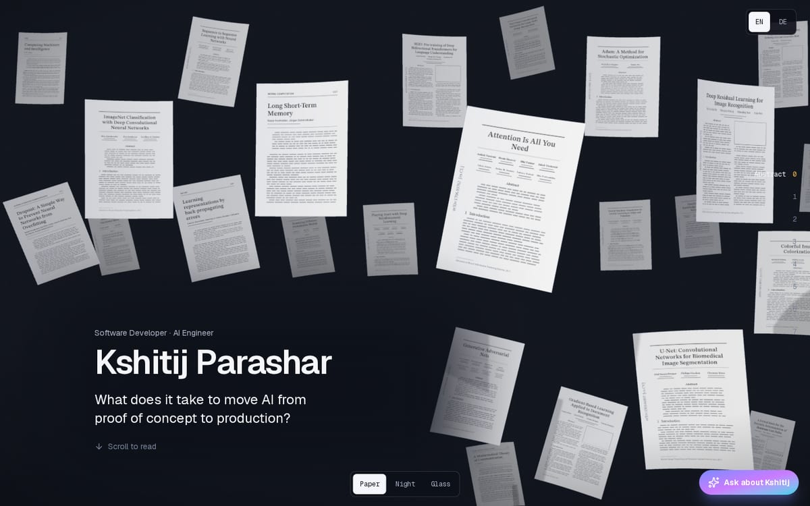
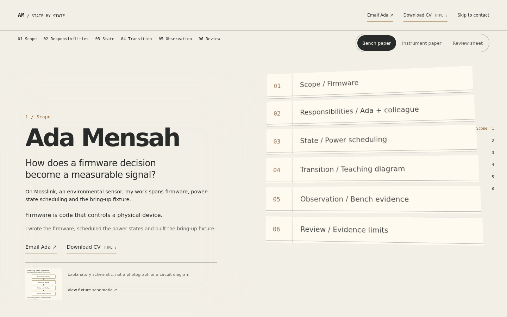

# Completed demo: visual quality rejected

11 October 2026. The author rejected `http://localhost:3011/` and asked for
a comparison with the originating `portfolio-website` repository. The
[exact feedback](../../../docs/history/2026-10-11-visual-quality-rejection.md)
is retained. This is a coordinator comparison, not a new paid build or
judge run. No frozen study, site source, shipped engine or skill was edited.

The criticism is supported. The demo is a functioning document rendered
partly as six rigid text strips. It falls substantially below the original's
authored detail, spatial storytelling and useful interactive scenes.
Technical checks did not establish those qualities. The earlier report's
focus on two smaller omissions understated the problem.

## Direct comparison

| Quality | Originating V3 | Finished demo |
|---|---|---|
| Object presence | Pages with detailed print, changing depth, bending and wrapping | Thin, nearly frontal rectangles carrying single-line labels |
| Story through space | Paper becomes a globe, network layers, sound relief, picture tiles and maze floor | Five of seven beats are tables or shallow table variants; others split labels into columns or three pairs |
| Surface detail | Covers, figures, maps, project plates, references and different print hierarchies | One repeated rule/number/label treatment across 42 faces |
| Working exhibits | Speech noise, image comparison and maze replay affect the scenes | No chapter extras or subject-specific controls; supplied diagrams remain small HTML figures |
| Materials and composition | Several camera/composition treatments, light and surface distinctions, optional reflective/glowing treatment | Fixed right-side anchor, matte strips, no floor; three largely color-only looks |
| Phone experience | Original engine/source provides adaptive scene treatment; original phone runtime was not freshly verified | At 390px the demo deliberately mounts no canvas, even with ordinary motion preference |

The [source comparison](source-comparison.md) provides exact paths, lines
and hashes. The [process review](process-review.md) traces the fixture,
prompts, implementation and acceptance criteria. Neither a downloaded model
file nor copying every original exhibit is necessary for convincing 3D.
The relevant loss is authored form, detail and explanatory behavior.

Above: the original repository's supplied V3 screenshot, not a fresh render.

Above: freshly captured demo opening at 1440 by 900. The original opening
surrounds its introduction with recognisable printed objects at different
depths and orientations. The demo gives comparable space to a contents list.
That compositional comparison is visual judgement, supported by the images;
it is not a measured score or a controlled same-viewport rendering test.

## Cause and responsibility

The coordinator chose a narrow regression case, retained six matte rows,
prescribed modest movement and a steady camera, disabled the mobile scene,
then scripted the look choice and prohibited reopening the concept. Those
are not the real author's creative preferences. The actor implemented an
especially minimal version: labels instead of artifact-bearing faces,
disconnected pairs instead of a connected diagram, and empty extras.

The extracted engine already allows custom geometry, drawn/image faces,
varied poses and lazy interactive extras. Those capabilities went unused.
Some bespoke V3 capabilities, including shared surface deformation and live
face repainting, are not exposed by the extracted contract. Their omission
was partly deliberate in the design, so this is not grounds to claim every
original effect was a forgotten engine requirement. The unproven part is
whether the reusable tools can deliver a comparably convincing different
story. A clean scaffold is insufficient evidence.

The 246 repository tests concern software behavior. The six-condition
browser checks concern structure, wording, modes, links and errors. The 49
screenshots are repeated mode coverage, not 49 rich scenes; six desktop
middle/end pairs are byte-identical. We reviewed them for clipping and
readability without enforcing the design's Backdrop, Depth and Swap tests.
This is a failure of scope and visual acceptance, not simply missing
screenshots. The previous implementation-complete wording must not be used
as a product-quality pass.

## Evidence and limits

[capture-demo.mjs](capture-demo.mjs) freshly captured five beats each at
1440 by 900 and 390 by 844 from port 3011 with software-WebGL Chromium.
[The manifest](visuals/manifest.json) records image hashes and scene state:
one canvas on desktop, zero on phone, and no page errors in either context.
These are selected settled frames, not a continuous-motion or physical-phone
performance assessment. The [image review](visuals/review.md) records the
remaining inspected frames; the coordinator directly inspected the original
screenshot, desktop Opening/Transition and phone State.

Original source HEAD was `163b8ceb302b7b4e5beeff8f1161f4cdc7663b15`.
It remained clean and unmodified. A faithful isolated runtime setup was
attempted offline, but locked dependencies were absent from the cache.
[Setup evidence](reference-setup/findings.md) records the failure. No new
original-site runtime or transition observation is claimed. Private files
were not needed or opened. This is source plus a supplied original image
compared with fresh demo browser evidence.

## Consequence for development

Stage 3's visual proof has failed for this demo. Keep its useful functional
results and immutable artifacts, and lead current status with the author's
rejection. The [recovery plan](../../../docs/superpowers/plans/2026-10-11-visual-quality-recovery.md)
requires a convincing opening, explanatory middle and resolving ending
before full-site expansion. Review actual movement, useful surface detail,
composition and a meaningful mobile presentation against the original's
standard of authorship. Retain factual honesty and accessible fallbacks.

This establishes a concrete saved miss for future build-quality questions.
It does not isolate the cause to skill wording, authorize another paid
conversation, or justify adding instructions without a matched rerun.
Current skill and engine bytes remain unchanged. Local verification and
preservation results are retained with this review.

## Verification

[verification.json](verification.json) records 192 demo source files still
matching the frozen final snapshot, a clean original checkout, eleven
matching image hashes and the byte-identical preceding handover archive.
All 467 checked local links resolved. No frozen build or shipped skill path
changed. `node evals/check-skill.mjs`, `node evals/check-people.mjs` and
`npm test` passed; the [test log](repository-tests.log) records 246 passed,
zero failed. Tests used the existing Node 22.22.1 verification environment
with approved Git subprocess access. These checks verify preservation and
repository health; they do not reverse the visual rejection.

A separate read-only consistency review checked nine current documents,
393 local links and their referenced heading anchors. It found no blocking
stage contradiction, attribution error or omitted author context. It
confirmed the same archive hash and prompted clarification that a
source-review runner exists even though the dedicated skill review entry
point is still absent. No additional model evaluation was run.
